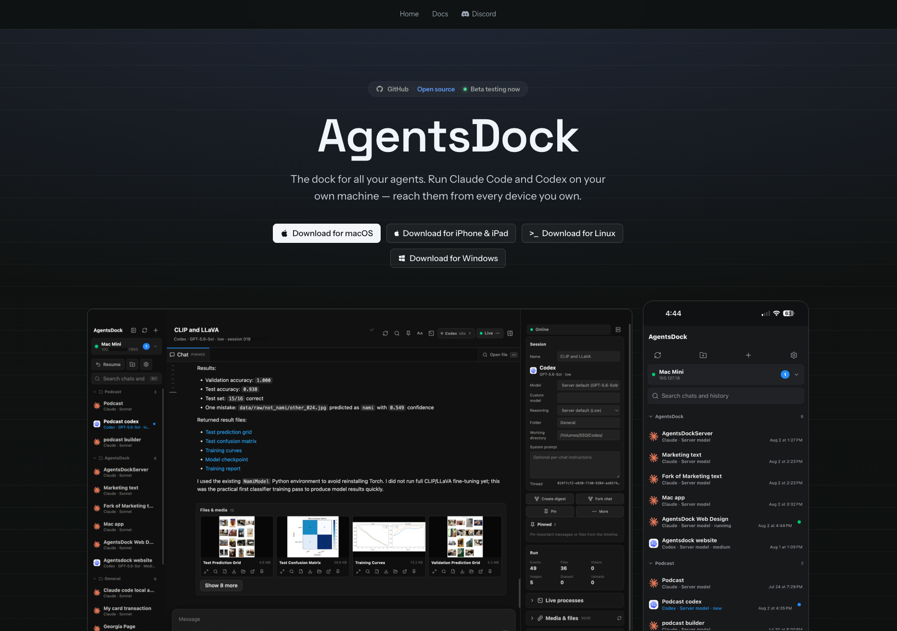

# AgentsServer



**AgentsServer is the self-hosted execution backend for
[AgentsDock](https://agentsdock.net).** AgentsDock provides
the polished desktop and mobile chat experience; AgentsServer runs on the
machine that owns your workspaces and agent CLI installations.
Together they provide persistent agent chats without routing private project
files through a third-party chat service.

The desktop and mobile client is also open source:
[ZhengyiLuo/AgentsDock](https://github.com/ZhengyiLuo/AgentsDock).

## Features

- Run agent chats from desktop and mobile, with persistent history.
- Work with files, images, videos, scheduled jobs, and persistent terminals.
- Use Claude Code, Codex, Cursor, OpenCode, or Gemini where supported by your server
  release, client, and installed CLI.
- Run independent servers on the same machine.

## Get started

Run the commands below **on the machine that will run your agents**. This can
be your desktop computer or another machine you control. Devices that only run
the AgentsDock app do not need these server prerequisites.

### 1. Prepare the server machine

| Prerequisite | What you need |
| --- | --- |
| Operating system | Apple silicon macOS with a desktop login, or Linux with a working `systemctl --user` session. Native Windows server installation is not supported; the Windows app can connect to a supported host. |
| Node.js and npm | [Node.js 22.14 or later](https://nodejs.org/en/download), including npm. |
| Python environment manager | [`uv`](https://docs.astral.sh/uv/getting-started/installation/). The installer uses it to prepare the server's Python runtime and dependencies. |
| Terminals and updates | `tmux` is required for persistent terminals and in-app managed updates. Basic chats work without it. |

On macOS with Homebrew, install the prerequisites with `brew install node uv tmux`.
On Linux, use the Node.js and uv installation guides above, and install tmux
through your distribution's package manager. Check them in the same terminal:

```sh
node --version
npm --version
uv --version
tmux -V
```

### 2. Install and check the server

Run as the server owner, without `sudo`:

```sh
npm install -g agentsdock
agentsdock list
```

On a fresh machine, the global install automatically creates and starts the
default server, normally on port **7850**. No npm account, repository clone,
or separate setup/start command is required. Installation needs internet access
to download the package and Python dependencies. Wait for it to finish and
confirm `default` is `running` in `agentsdock list`.

Existing default or named installations and history are left unchanged;
installing the npm CLI again does not update or restart a running server.
Use `agentsdock new` to add another independent server.

### 3. Connect AgentsDock and start a chat

Use the installer output or `agentsdock list` to find the server URL. To retrieve
the default server's access token without reinstalling or restarting:

```sh
agentsdock token default
```

Download the [desktop app](https://github.com/ZhengyiLuo/AgentsDock/releases/latest)
or [mobile app](https://agentsdock.net/#downloads), then add the URL and token.
Choose the address from `agentsdock list` that matches where the app is running:

| App location | Server URL to use |
| --- | --- |
| Same computer as the server | The **This machine only** URL, normally `http://127.0.0.1:7850`. |
| Another device on the same Wi-Fi/LAN | The listed **Same Wi-Fi / LAN** address and port. |
| Another network | The listed **Tailscale / other networks** address, with both devices connected to your private tailnet. |

A localhost-only binding cannot accept connections from another device.
Do not enter `127.0.0.1` on your phone to reach a server on your computer.
Keep tokens private and do not expose the agent port directly to the public internet.

Install and sign in to your preferred agent CLI on the **server machine**.
AgentsDock does not install or authenticate Claude Code, Codex, Cursor or
OpenCode for you. In the desktop app, check **Settings → My Agents**, then
create a chat with that agent and a working directory on the server.
Gemini uses an API connection in My Agents, not Google/CLI sign-in, and requires
Gemini CLI 0.64.0. It is built in without a feature flag in versions containing
the integration; see [Gemini setup and supported features](docs/GEMINI_PROVIDER_PREVIEW.md).
The npm package installs the server and CLI; the app is a separate download.

### If setup did not finish

| What happened | Next step |
| --- | --- |
| `uv` or another prerequisite is missing | Install the prerequisite, verify it in the same terminal, then retry `agentsdock setup` if the CLI is available. Otherwise rerun `npm install -g agentsdock`. |
| Setup reports existing installation or state | Use `agentsdock list` to inspect it. Update existing servers through the app, or use `agentsdock new` for an additional instance. Do not delete history to force a fresh setup. |
| npm finished, but no server was created | Local installs, CI and `--ignore-scripts` skip automatic setup. Run `agentsdock setup` for a fresh default server, or `npx agentsdock setup` after a local npm install. |
| `agentsdock: command not found` | Check that you used `-g` and your npm global executable directory is on `PATH`. See [npm's global-install permission guidance](https://docs.npmjs.com/resolving-eacces-permissions-errors-when-installing-packages-globally); do not solve this with `sudo npm install`. |
| The app cannot connect | Check the instance is running, use its actual address and port, and retrieve its token again. For another device, check the binding, network and firewall. |

To choose a custom port/bind before first setup, or deliberately install a beta,
see the [CLI setup instructions](npm/agentsdock/README.md#install-the-command).

### Install from source (advanced)

The source installer remains available for development and checkout-based
installations:

```bash
git clone https://github.com/ZhengyiLuo/AgentsDock.git
cd AgentsDock/server
./install.sh
```

In that checkout, `./install.sh --show-token` reads an existing default token.

### Memory at launch

Available-memory admission floors are disabled by default. Operators can choose
a positive floor for new turns or scheduled jobs; existing explicit settings
remain effective. See [memory settings](docs/MEMORY_ADMISSION.md).

## Multiple servers on one machine

Add a separate server without replacing your original/default server:

```sh
# Create a server with an automatic name and free port
agentsdock new

# Or choose its name and port
agentsdock new work --port 7851

# List all servers and their connection URLs
agentsdock list

# Uninstall one server (replace work with its name)
agentsdock remove work
```

Removal asks for confirmation and preserves history by default. Select the
instance explicitly; bare `agentsdock remove` never selects all servers.

Named instances retain separate legacy service units. The default server keeps
the current split service lifecycle; `--execution-mode split` is rejected for
named instances to avoid taking over the default gateway.

## Updating

Use the app's managed update controls for an installed server. Updating the npm
CLI alone leaves its running server unchanged. Signed updates preserve the
server's token and chat history. A paired desktop release updates the app first,
then reconciles its saved servers. Busy servers wait for idle; offline servers
resume after reconnecting. Check each server's result: a failed update needs
Retry, and an older unsupported installation may need a guided upgrade.
See the [release notes](https://github.com/ZhengyiLuo/AgentsDock/releases/latest)
for the current release's validation limits.

For the default server installed from a checkout:

```bash
git pull --ff-only
./install.sh
```

## Documentation and support

- [Detailed API, configuration, and lifecycle reference](docs/SERVER_REFERENCE.md)

- [Setup and connection help](https://agentsdock.net/setup.html)
- [AgentsDock features](https://agentsdock.net/features.html)
- [Server releases](https://github.com/ZhengyiLuo/AgentsServer/releases)
- [Report a server issue](https://github.com/ZhengyiLuo/AgentsDock/issues)
- [Contributing and tests](CONTRIBUTING.md)

Features in this checkout may not yet be in a published release. The maintained server source is this repository's `server/` directory. The
standalone AgentsServer repository remains a compatibility distribution during
the update migration.

### CLI reference

The published [`agentsdock` CLI](npm/agentsdock/README.md) is the short entry
point. It pins the same-version `@agentsdock/server` runtime and preserves the
signed update protocol. Existing scoped-package installations remain supported.
See the CLI reference for command options, source-only features and native
instance-management acceptance limits.

## License

AgentsServer's original code and documentation are licensed under the
[Apache License 2.0](LICENSE). See [NOTICE](NOTICE) for attribution.
Third-party components retain their respective copyrights and licenses.
